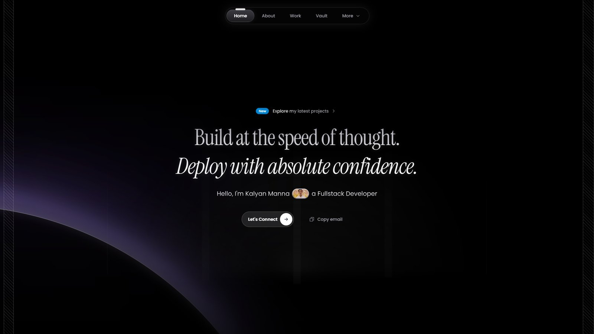
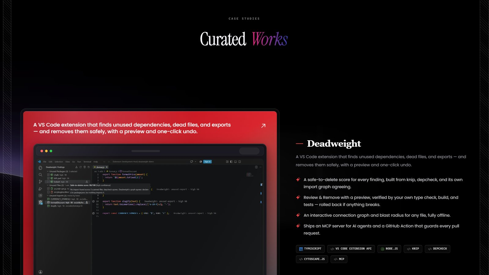
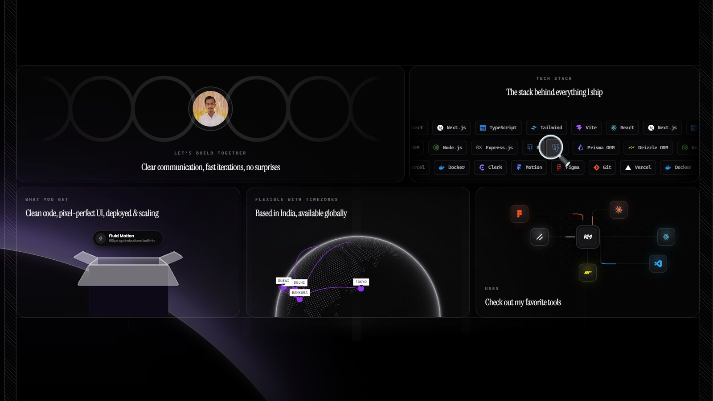
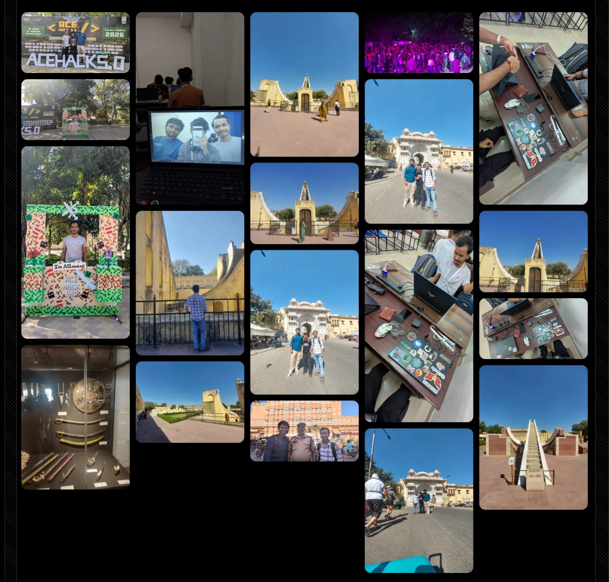
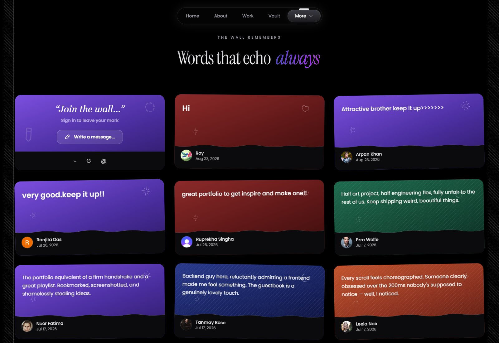

<div align="center">

# Hi, I'm Kalyan Manna 👋

**Full-stack developer & freelancer from Kharagpur, India**

I build fast, modern, and scalable websites, web apps, mobile apps, and digital products.

[**kalyanmanna.com**](https://www.kalyanmanna.com) · [LinkedIn](https://www.linkedin.com/in/kalyan-manna) · [X](https://x.com/Kalyan_Manna_4) · [Book a call](https://cal.com/kalyanmanna) · [Email](mailto:kalyanmanna439@gmail.com)


</div>

<br />

<a href="https://www.kalyanmanna.com">
  
</a>

## About me

I'm a full-stack developer, freelancer and problem solver. I care about the whole
product, from clean architecture and maintainable code on the backend to
interfaces that feel fast, polished and intuitive.

I work mostly across the TypeScript ecosystem: React and Next.js on the web, Expo
for mobile, and Node.js with PostgreSQL behind them. Lately I've been building
developer tools too.

Outside client work you'll find me at hackathons and community meetups like
HackRIT, AceHack and React Kolkata, building under pressure and meeting people
worth knowing.

> **Open to work:** I'm available for full-time roles and freelance projects.
> [Let's talk](https://www.kalyanmanna.com/contact).

## What I've built

| Project | What it is |
| --- | --- |
| [**Deadweight**](https://marketplace.visualstudio.com/items?itemName=kalyanmanna.deadweight) | A VS Code extension that finds unused dependencies, dead files and exports, and removes them safely with a preview and one-click undo. Ships an MCP server for AI agents and a GitHub Action. |
| [**Keythm**](https://keythm-two.vercel.app) | A typing trainer built for the feel of it: customisable tests, live WPM and accuracy, and a mechanical keyboard that thocks under every keystroke. |
| [**EasyPG**](https://github.com/Kalyan-github-4/EasyPG-App) | A PG discovery and management app for students and property owners, covering real-world rental and booking workflows. |
| [**GitHub Roast**](https://git-hub-roast-mauve.vercel.app/) | A web app that analyses GitHub profiles and serves up witty roasts, humorous insights and a developer score. |
| [**HopeBridge**](https://ngo-portfolio-2.vercel.app) | A multi-page site for an NGO working with vulnerable children across India: causes, impact reporting and a donation flow front and centre. |

More case studies are on [kalyanmanna.com/work](https://www.kalyanmanna.com/work).



## My stack

- **Frontend:** React · Next.js · TypeScript · Tailwind CSS · Framer Motion · Vite
- **Backend:** Node.js · Express · PostgreSQL · Drizzle ORM · Prisma
- **Mobile:** Expo · React Native
- **Tools & platforms:** Git · Docker · Vercel · Render · Neon · Clerk · Figma



## Moments & memories

The [Vault](https://www.kalyanmanna.com/vault) on my site is where I keep photos
from the hackathons and events I've been part of. Here's
[AceHack 5.0](https://www.kalyanmanna.com/vault/acehack-5-0): long build hours,
a team that kept going, and the people met along the way.

<a href="https://www.kalyanmanna.com/vault/acehack-5-0">
  
</a>

## Sign the guestbook

Visitors leave notes on [the wall](https://www.kalyanmanna.com/more/guestbook).
If you've stopped by, I'd love to read yours.

<a href="https://www.kalyanmanna.com/more/guestbook">
  
</a>

## About this repo

This is the source for [kalyanmanna.com](https://www.kalyanmanna.com): a Next.js
app whose route handlers in [`src/app/api`](src/app/api) (backed by Drizzle and
Neon Postgres) power the guestbook and feedback.

### What's on the site

| Page | What it does |
| --- | --- |
| [`/`](https://www.kalyanmanna.com) | Hero, bento grid (tech stack, timezone globe, tools), curated work, vault and explore sections |
| [`/work`](https://www.kalyanmanna.com/work) | Case studies, each with its own detail page |
| [`/about`](https://www.kalyanmanna.com/about) | Background, hackathon wins and a photo carousel |
| [`/vault`](https://www.kalyanmanna.com/vault) | Photo collections from events, in a masonry gallery with a lightbox |
| [`/contact`](https://www.kalyanmanna.com/contact) | Message form (opens your email app) and Cal.com booking |
| [`/more/guestbook`](https://www.kalyanmanna.com/more/guestbook) | Clerk sign-in, visitor notes with admin approval, pinned notes |
| [`/more/links`](https://www.kalyanmanna.com/more/links), [`/more/uses`](https://www.kalyanmanna.com/more/uses), [`/more/bucket-list`](https://www.kalyanmanna.com/more/bucket-list) | Link hub, gear and software I use, and my bucket list |

### Built with

- **Framework:** Next.js 16 (App Router) · React 19 · TypeScript
- **Styling & motion:** Tailwind CSS 4 · Framer Motion · Lenis · GSAP · Radix UI · Vaul
- **Graphics:** custom WebGL shaders · cobe (globe) · Three.js with React Three Fiber
- **Data & auth:** Neon Postgres · Drizzle ORM · Clerk · Zod
- **Services:** Cal.com embed · Vercel

### Project structure

```
src/
├── app/          # Routes (App Router) and API route handlers in app/api
├── views/        # Page-level components that the routes render
├── components/   # UI, grouped by feature (hero, bento, footer, navbar, vault, work…)
├── config/       # Site metadata, social links, media
├── data/         # Content: projects, journey/vault entries, uses, bucket list
├── server/       # Server-only code: database, Clerk auth, guestbook admin
├── auth/         # Clerk sign-in, sign-up and SSO screens
├── lib/          # Shared helpers
└── styles/       # Global CSS and keyframes
```

Most content lives in [`src/data`](src/data) and [`src/config`](src/config), so
adding a project or a vault collection doesn't mean touching components.

### Performance on phones and low-end machines

The site adjusts how much it animates based on the device, so it stays smooth on
phones and older laptops:

- **Native scrolling on touch devices.** Smooth scrolling (Lenis) applies to the
  mouse wheel only. Phones scroll natively.
- **Still backgrounds on low-power devices.**
  [`isLowPowerDevice()`](src/lib/low-power.ts) matches touch-first devices,
  machines with 4 or fewer CPU threads or 4 GB of memory or less, and Data Saver.
  On those devices the shader backgrounds, the footer particles and the gradient
  headings render one still frame instead of animating.
- **No animation off screen.** The canvas backgrounds, the bento globe and the
  gradient headings pause when they scroll out of view (the canvases and globe
  also pause when the tab is hidden).
- **Mouse-only effects stay mouse-only.** The magnetic buttons and the wand
  cursor ignore touch.
- **Lightweight blur.** No scroll-driven blur filters, and only light or no
  backdrop blur on the pinned navbar.
- **Reduced motion respected.** With the OS "reduce motion" setting on, smooth
  scrolling is off and animations hold still.

<details>
<summary><strong>Running it locally</strong></summary>

<br />

You'll need Node.js 20 or later.

```bash
git clone https://github.com/Kalyan-github-4/Kalyan-Manna-Portfolio.git
cd Kalyan-Manna-Portfolio
npm install
```

Copy [`.env.example`](.env.example) to `.env.local` and fill it in:

```env
# Build time: inlined into the client bundle, so set these before `npm run build`
NEXT_PUBLIC_CLERK_PUBLISHABLE_KEY=your_clerk_publishable_key
NEXT_PUBLIC_CAL_LINK=your_cal_com_link

# Server only: read at runtime by the route handlers
DATABASE_URL=your_neon_postgres_database_url
CLERK_SECRET_KEY=your_clerk_secret_key
ADMIN_EMAIL=you@example.com
```

`.env.example` also lists optional `SMTP_*` and `CONTACT_*` values for the
`/api/contact` route. The site's contact form uses `mailto:` and doesn't call
that route, so you can leave them out.

Then start the dev server on [localhost:3000](http://localhost:3000):

```bash
npm run dev
```

| Script | What it does |
| --- | --- |
| `npm run dev` | Start the dev server |
| `npm run build` / `npm start` | Production build and server |
| `npm run lint` | ESLint |
| `npm run typecheck` | TypeScript check, no output |
| `npm run format` | Prettier (with the Tailwind class sorter) |
| `npm run db:generate` | Generate a Drizzle migration from the schema |
| `npm run db:migrate` | Apply migrations to `DATABASE_URL` |
| `npm run db:studio` | Open Drizzle Studio |

The site deploys to Vercel from the repo root. `NEXT_PUBLIC_*` values are inlined
at build time, so set them in Vercel before the build runs.

</details>

## License

This project is for my personal portfolio. If you use parts of the design or
structure, please give credit.
